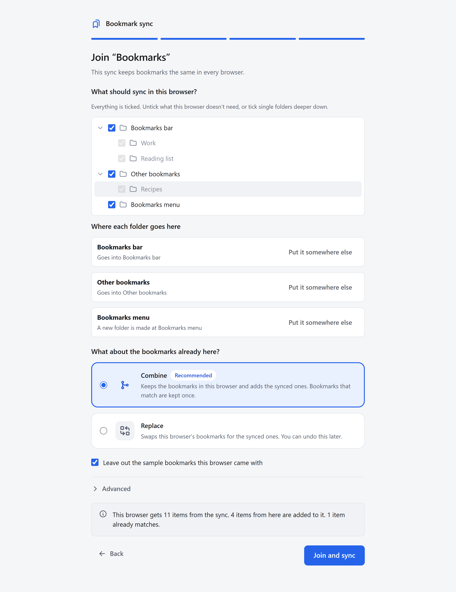
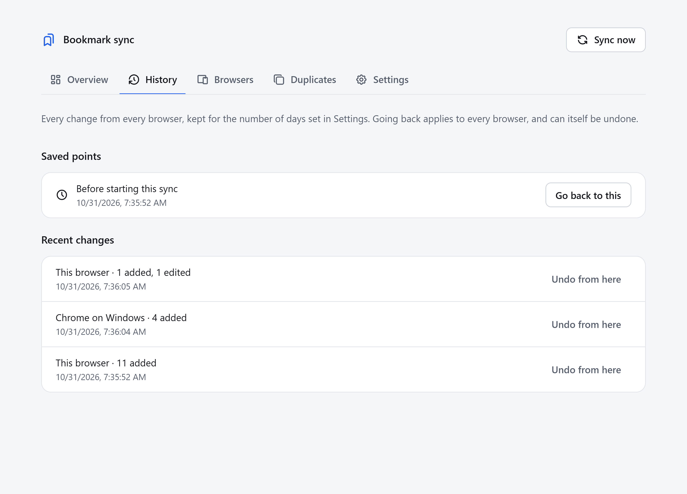
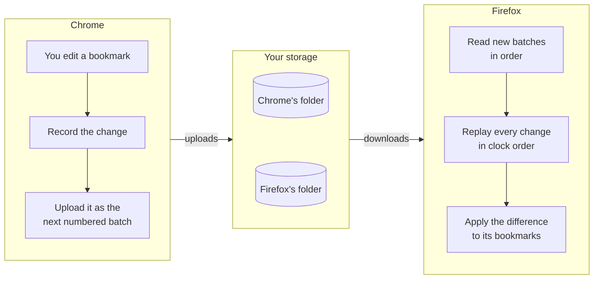
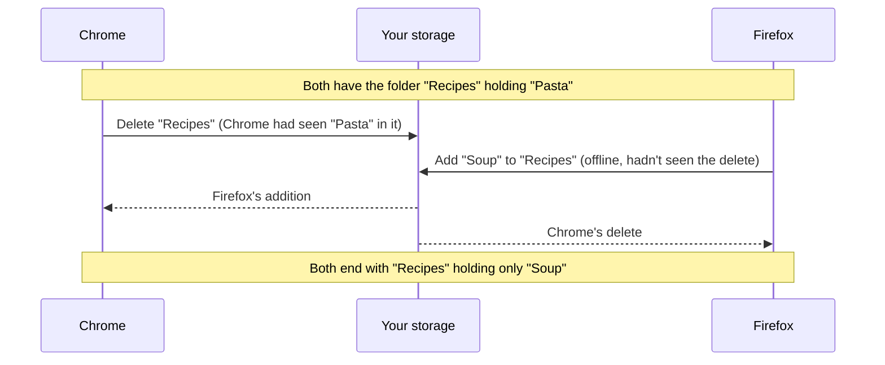

# Bookmark sync

**Your bookmarks, the same in every browser.**

https://github.com/user-attachments/assets/5849f818-9aca-4ffa-b06b-f3697e4647b6

Bookmark sync is a browser extension that keeps your bookmarks in step across Chrome, Edge, Brave, Vivaldi and Firefox. Add a bookmark in one browser and it appears in the others. Your bookmarks are stored in your own Google Drive or on your own server, never on ours.

[Features](#features) · [Install](#install) · [Getting started](#getting-started) · [Privacy](#privacy) · [How it works](#how-it-works) · [Website](https://ehsan18t.github.io/bookmark-sync/)

## Why

Every browser has its own bookmark sync, and they don't talk to each other. Use Chrome at work and Firefox at home, or keep Edge around for one site, and your bookmarks drift apart. Bookmark sync joins them into one set, through storage you already have.

## Features

- **One set of bookmarks for every browser.** Chrome, Edge, Brave, Vivaldi and Firefox, on as many computers and browser profiles as you like.
- **Changes sync as they happen.** A new bookmark, a rename or a move is uploaded a few seconds after you make it. Your other browsers pick it up within about 30 seconds, and right away when you switch to them.
- **Edits from different browsers merge cleanly.** Rename a bookmark in one browser and change its address in another, and both changes apply. Work offline, and everything merges when you're back. Nothing is lost and nothing is doubled.
- **Storage you choose.** Google Drive, or any WebDAV server: Nextcloud, ownCloud, Synology, Koofr, or any cloud that [rclone](https://rclone.org/) can reach.
- **Sync everything, or just some folders.** Each browser chooses which synced folders it holds and where they go, so a work browser can share one folder with a personal one and keep the rest separate. You can also run several separate syncs side by side.
- **Optional encryption.** Your bookmarks are encrypted in the browser with a passphrase only you know, before anything is uploaded.
- **History and undo.** Every change from every browser is kept for 7 days (you can change this). Go back to any point, and the undo reaches every browser. An undo can itself be undone.
- **Protection from accidents.** If a sync would delete, move or edit more than a fifth of your bookmarks, it stops and asks you first.
- **Duplicate finder.** Finds bookmarks that point to the same page. Nothing is removed until you choose, and a cleanup can be undone.
- **Guided setup.** Pick your storage, then start a new sync or join an existing one. When joining, combine this browser's bookmarks with the synced ones or replace them, with a live preview of what will change.

  
  

## Install

Bookmark sync isn't in the browser stores yet. Until it is, install it from a release:

1. Download the zip for your browser from the [latest release](https://github.com/ehsan18t/bookmark-sync/releases/latest): the `chrome` zip for Chrome, Edge, Brave and Vivaldi, or the `firefox` zip for Firefox.
2. Unzip it.
3. Load it:
   - **Chrome, Edge, Brave or Vivaldi** (version 134 or later): open the browser's extensions page, turn on **Developer mode**, choose **Load unpacked**, and pick the unzipped folder.
   - **Firefox** (version 140 or later): open `about:debugging#/runtime/this-firefox`, choose **Load Temporary Add-on**, and pick `manifest.json` in the unzipped folder. Firefox removes temporary add-ons when it closes, so on Firefox this is for trying it out until the add-on is listed on addons.mozilla.org.

## Getting started

The setup page opens when you install the extension. It goes one step at a time:

1. **Choose storage.** Google Drive, or your own server. For Nextcloud and ownCloud, the address is shown in Files, under Settings at the bottom left, and looks like `https://cloud.example.com/remote.php/dav/files/USERNAME/`. Use an app password. For rclone, run `rclone serve webdav REMOTE: --addr 127.0.0.1:8080 --user me --pass secret` and use `http://127.0.0.1:8080/`.
2. **Connect.** The extension checks the sign-in before going on.
3. **Start or join.** The first browser starts a sync. In each other browser, choose the same storage, and the setup page offers to join the sync it finds there.
4. **Choose what to sync.** All bookmarks, or the folders you tick. When joining, choose **Combine** (keep this browser's bookmarks and add the synced ones) or **Replace** (take the synced ones, which can be undone).

After setup, the toolbar button shows the state of each sync, and the dashboard has Overview, History, Browsers, Duplicates and Settings tabs.

> [!IMPORTANT]
> Turn off the browser's own bookmark sync in any browser that uses Bookmark sync and shares a Google, Microsoft or Firefox account with another browser that also uses it. Otherwise both syncs carry the same changes. Bookmark sync notices this, repairs the duplicates and pauses, but it's simpler to avoid. Keeping the browser's own sync on as a backup for a single browser is fine.

## Privacy

- Your bookmarks go only to the storage you choose. There is no Bookmark sync server, no account to create and no analytics.
- The extension can reach your server only after you connect it, and only that server's address.
- With encryption on, every file is encrypted before upload. Your storage can see file names and sizes, but not your bookmarks. You enter the passphrase once per browser session, or let the browser remember it.

The full [privacy policy](https://ehsan18t.github.io/bookmark-sync/privacy.html) is on the website.

## Status

Bookmark sync is new. The sync engine is covered by a large set of automated tests, and the extension has been run end to end in Chromium. Firefox, Edge, Brave and Vivaldi builds exist but haven't been run in those browsers yet, and Google Drive and Nextcloud haven't been tried with real accounts. If something goes wrong, please [open an issue](https://github.com/ehsan18t/bookmark-sync/issues).

It syncs bookmarks and folders only: not passwords, history, Firefox tags and keywords, or favicons. Mobile browsers and Safari aren't supported.

## How it works

This part is for the curious. Bookmark sync doesn't compare whole bookmark trees and guess what changed. It records each change as it happens, much like a database's write-ahead log, and every browser replays the same log by the same rules. Given the same changes, every browser arrives at exactly the same bookmarks.

### Changes are recorded, uploaded and replayed

When you edit a bookmark, the extension compares the folder with its last known copy and records exactly what changed: one item added, edited, moved or deleted. A few seconds later, the recorded changes go up as the next numbered batch in this browser's own folder on your storage. Every other browser reads those batches in order, replays all changes from all browsers, and applies only the difference to its own bookmarks.

This design is what makes it reliable:

- **Each browser writes only its own files.** No file is ever shared or overwritten, so two browsers can never clobber each other's work, and the server needs no locking.
- **Batches are numbered, chained and written once.** Each batch records a hash of the one before it. Browsers read every batch strictly in order, and a file that fails to download is retried, never skipped. A copied browser profile shows up as a broken chain and gets its own identity.
- **Every change carries a hybrid logical clock timestamp.** Replay sorts all changes by it, so the same changes give the same bookmarks in every browser, whatever order they arrived in. A browser whose clock is more than 2 minutes off pauses instead of writing.
- **The log stays small.** Old changes are folded into a snapshot once every browser has moved past them and they're older than the history window.

### When two browsers disagree

The rules for conflicting edits are fixed and tested, so the outcome never depends on timing luck. The hardest case is a folder deleted in one browser while another browser, offline, adds something to it:

A delete removes exactly what the deleting browser saw, so the new bookmark survives and its folder comes back to hold it. The other rules:

| When two browsers... | The result |
|---|---|
| edit the same field (a title or an address) | the later edit wins |
| edit different fields of the same bookmark | both edits apply |
| move the same item to different places | the later move wins |
| delete an item while another edits or moves it | the delete wins, and the edit stays in History |
| move a folder into itself, through concurrent moves | the move that would close the loop is skipped |

### Safety nets

- **Large changes wait for you.** A sync that would delete, move or edit more than 20% of a sync's bookmarks (at least 10 items) pauses and asks. You can apply it, or revert just the items it touched in every browser.
- **Interrupted syncs finish.** Changes to the browser's bookmarks are applied from a saved plan, so a crash or a closed browser midway picks up where it stopped on the next start.
- **Nothing is rewritten.** A restore or an undo is recorded as new changes, so it syncs like any edit and can itself be undone.
- **Joining is reversible.** Before a browser joins a sync, its own bookmarks are saved and the sync gets a restore point. Undoing the join puts them back.
- **Encryption is standard.** AES-256-GCM, with a key derived from your passphrase by PBKDF2-SHA256 at 600,000 iterations. Each file is bound to its own path, so files can't be swapped for one another.

### Tested hard

- Randomized tests run up to 5 simulated browsers that make concurrent edits, hold only some folders, lose network responses and have skewed clocks, and check every outcome against a plain tree model.
- Scenario tests cover crashes, lost responses, copied browser profiles, browsers that left, and bookmarks the browser renumbered.
- End-to-end tests load the real extension into two Chromium profiles syncing through a WebDAV server and click through the setup pages.

The full design is in [SPEC.md](SPEC.md) (behavior and decisions) and [IMPLEMENTATION.md](IMPLEMENTATION.md) (the code, module by module).

## Contributing

Building from source, running the tests, publishing, and the code layout are covered in [docs/development.md](docs/development.md).
